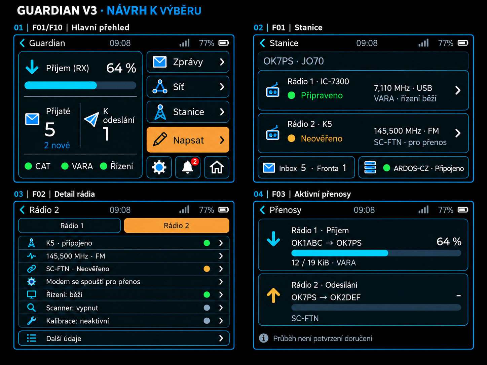
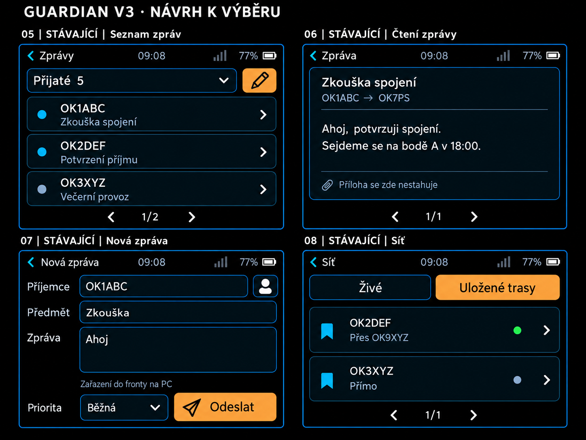
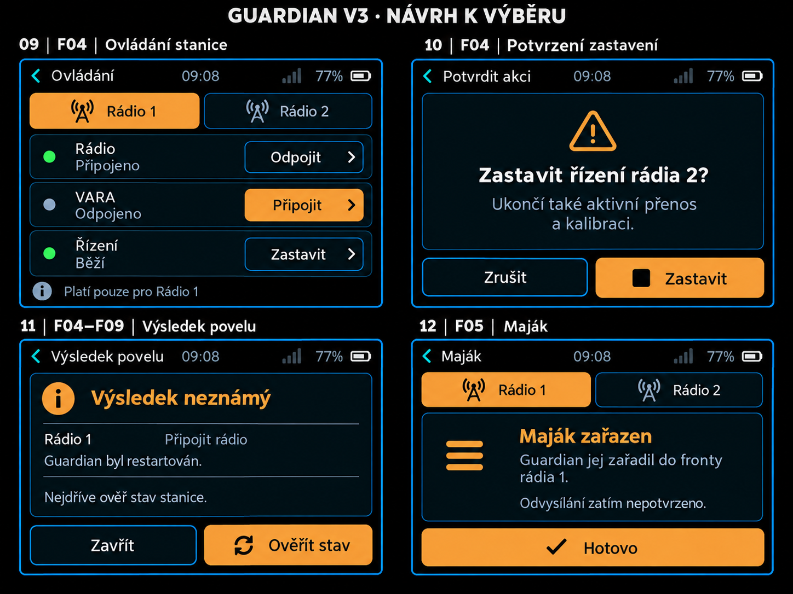
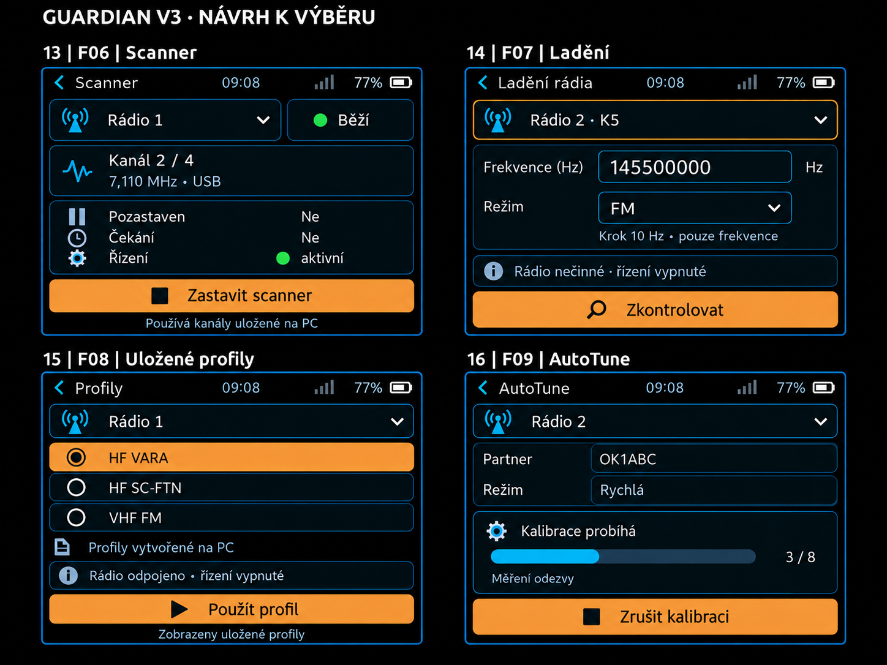
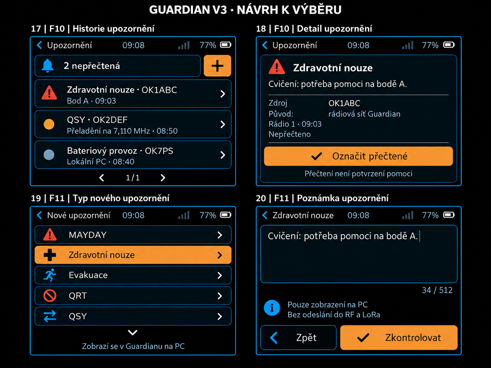
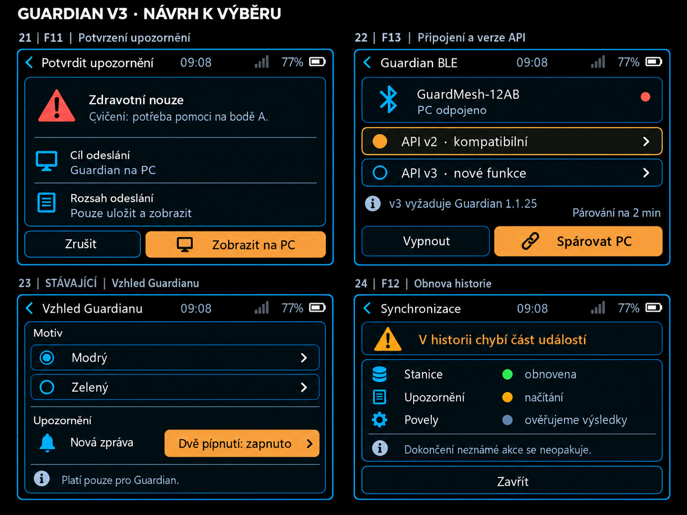
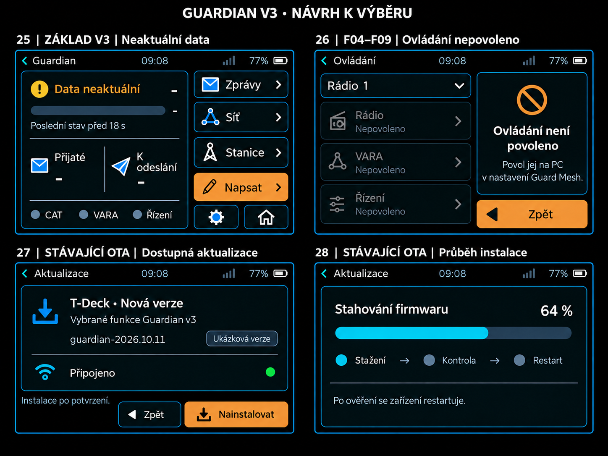

# Guardian v3 návrh funkcí pro T Deck

## Schválený výběr

Uživatel odeslal [volby a komentáře](review-data/selection.json) 11. října 2026.
Implementují se **F01, F02, F03, F04a/b/c, F05, F07, F08, F09 a F10** pro
**T-Deck / T-Deck Plus**. Nouzové kódy 1–3 probudí displej, opakují pípání
a zůstanou viditelné do trvalého označení jako přečtené. Obrazovky OTA 27/28
jsou dokončené. Samostatný advert.send API neposkytuje, dostupný je beacon.send.
**F11 je odložená a její návrh zachovaný; F12 a F13 jsou odmítnuté.**
Firmware používá pouze API v3, bez přepínače v2. Heltec BLE se řeší později.
Dočasná výběrová webovka byla odstraněná; uložené zadání a návrhy zůstávají.

Implementovaný vzhled je zdokumentován v [17 skutečných českých snímcích
firmwaru](screens/README.md). Rozložení stanice, ovládání, přenosů, upozornění,
potvrzení a OTA bylo přepracováno podle odsouhlasených návrhů.

Následující nabídka a obrázky zachovávají původní návrh. Doporučení a odmítnuté
funkce v této historické části nepřepisují schválený výběr výše.

**Doporučuji F01, F02, F03 a F10**, doplněné kompatibilitou F13 a společným technickým základem. Tato sestava ukáže stanici, obě rádia, přenosy a upozornění bez ovládání rádiového provozu. Ovládání, maják, ladění, profily, kalibraci a odesílání upozornění lze vybrat jednotlivě.

**Scanner F06 je vyřazený.** Dodaný dokument API uvádí `scanner.start`, `scanner.stop` a stavová pole scanneru, ale uživatel potvrzuje, že Guardian tuto funkci nemá. Dokumentace API sama neověřuje existenci funkce v používaném Guardianu. Scanner nebude součástí nabídky ani implementace; jeho původní ukázka 13 je neplatná a řádek scanneru v ukázce 03 se vynechá. ID ostatních funkcí zůstávají zachovaná.

## Funkce k výběru

| ID | Co konkrétně získáme | Doporučení pro první verzi | Ukázky |
|---|---|---|---|
| **F01** | Přehled stanice: volací znak, dvě rádia, frekvence a mód, připravenost, schránka a stav ARDOS-CZ. | **Ano** | 01–02 |
| **F02** | Detail jednoho rádia: modem, řízení, kalibrace a důvod nepřipravenosti. Zobrazení funguje i bez povolení ovládání. | **Ano** | 03 |
| **F03** | Detail souběžných přenosů: zvlášť rádio 1 a 2, směr, protistrany, použitý modem, bajty, procenta a rychlost, pokud jsou známé. | **Ano** | 04 |
| **F04a** | Připojit nebo odpojit **driver vybraného rádia**. | Volitelné | 09, 11, 26 |
| **F04b** | Připojit nebo odpojit **VARA modem** vybraného rádia. SC-FTN/ARDOP nemají stejný trvale běžící payload modem. | Volitelné | 09, 11, 26 |
| **F04c** | Spustit nebo zastavit **řízení** vybraného rádia. Zastavení může ukončit i přenos a kalibraci, proto má potvrzení. | Volitelné | 09–11, 26 |
| **F05** | Zařadit maják do fronty vybraného rádia. Výsledek se jmenuje „Maják zařazen“. | Volitelné | 12 |
| **F07** | Naladit frekvenci a povolený mód vybraného rádia. Pro K5/K61 pouze FM a frekvence v kroku 10 Hz. | Spíše později | 14 |
| **F08** | Použít již uložený profil z Guardianu. Nevytváří ani neupravuje profily. | Spíše později | 15 |
| **F09** | Spustit nebo zrušit SC-FTN AutoTune s vybraným partnerem, rychlým/plným režimem a průběhem. | Spíše později | 16 |
| **F10** | Přijímat upozornění, prohlížet trvalou historii a detail, zobrazit původ a vědomě označit upozornění přečtené. | **Ano** | 17–18 |
| **F11** | Z T-Decku vytvořit upozornění z nabídky typů, přidat poznámku do 512 znaků a **uložit a zobrazit je na PC**. | Volitelné | 19–21 |
| **F12** | Samostatný přehled obnovy spojení a historie: co se obnovilo, co ještě načítáme a zda v historii chybí část událostí. | Spíše později | 24 |
| **F13** | V nastavení vědomě přepnout mezi API v2 a v3; v3 vyžaduje Guardian 1.1.25 s podporou v3. | Součást přechodu na v3 | 22 |

F04 v obrázcích označuje společnou obrazovku, ze které lze vybrat **a, b, c nezávisle**. Stejně tak F07–F09 nevyžadují výběr všech voleb F04; sdílejí pouze oprávnění a bezpečné vyhodnocení povelů. F11 navrhuji spojit s F10, aby šlo odeslané upozornění později dohledat.

**F14, Guardian BLE na Heltecu V4 TFT, je odložené.** Současný transport Guardian BLE je omezený na T-Deck; samotné přidání API ani vydání OTA jej na Heltecu nezpřístupní.

## Zachované části a navigace

Zůstávají zprávy a jejich složky, čtení textu, koncepty a zařazování zpráv do fronty PC, živé kontakty a uložené trasy, párování v nastavení a modrý/zelený vzhled Guardianu. Ukázky 05–08 a 23 připomínají jejich vzhled; nejde o nové funkce k výběru.

Základ návrhu tvoří současné rozložení A3, černé pozadí, tmavé karty, modré obrysy a oranžové hlavní akce. F01 přidá do pravého sloupce tlačítko **Stanice**. F10 přidá zvonek s počtem nepřečtených upozornění. Pokud některou část nevybereme, její vstup nebude zabírat místo. Pokročilé ovládání bude uvnitř detailu vybraného rádia; hlavní přehled se nezaplní všemi povely.

Na displeji 320 × 240 budou krátké řádky, stránkování či posun. Delší diagnostika se otevře zvlášť. Modrý štít znamená připojení PC; připravenost stanice se hodnotí samostatně.

## Společný základ pro vybrané funkce

Tyto části nejsou další tlačítka k výběru. Zajišťují, aby zvolená varianta API v3 správně fungovala:

- Kompletní zabezpečená služba v3 včetně Event Write, fyzického párovacího okna a zachování oddělení od MeshCore UART. Response a Event se skládají nezávisle, i při shodném transfer ID.
- Po připojení načtení capabilities a stanice, bezpečná obsluha událostí, obnova po výpadku a potvrzení pouze trvale zpracovaného souvislého úseku. Event transport je ve v3 povinný i bez obrazovky F10; obrazovka F12 je volitelná, samotná obnova nikoli.
- Připravenost **ano / ne / neověřeno**. Po 15 s bez čerstvého Status se stav označí jako neaktuální. Události ani RPC jej samy neomladí. Neznámá procenta jsou „–“; 100 % neznamená doručení.
- U F04–F09 vždy výslovný výběr rádia 1 nebo 2, povolení na PC a aktuální dostupnost z capabilities. Nedostupná akce ukáže konkrétní důvod. Zařízení si oprávnění samo neudělí.
- U F04–F09 a F11 trvalé uložení obsahu a UUID před odesláním. Chyba uložení zakáže odeslání. Výsledek povelu rozlišuje čekání, dokončení, zařazení, selhání a neznámý výsledek; `ok:true` není samo o sobě úspěch povelu.
- Po neznámém výsledku či delší odmlce nejprve obnovit stav a výsledek. Neopakovat automaticky staré provozní akce ani upozornění.

API v2 zůstane výchozím kompatibilním režimem po aktualizaci existujícího zařízení. Přechod na v3 proběhne vědomě při odpojeném PC a obnoví BLE službu; automatický downgrade není součástí smlouvy. Tuto volbu navrhuji kvůli starším PC, která Protocol v3 odmítnou.

## Přesný význam upozornění a povelů

F11 znamená **zobrazení a uložení v Guardianu na PC**. API v3 tato upozornění automaticky neposílá do RF ani MeshCore/LoRa. Poznámka má až 512 Unicode znaků a zachovává diakritiku. Nabídku názvů a priorit čteme z `alert.types`, nikoli z vlastních odhadů.

U F10 potvrzení příjmu události není označení přečtené. Tlačítko „Označit přečtené“ volá samostatné `alert.seen`; stav přečtené znamená přečtení alespoň jedním BLE zařízením. Nepotvrzuje zásah nebo pomoc.

F05 potvrzuje zařazení majáku, nikoli odvysílání. F08 nabízí jen profily poskytnuté PC; pokud je vráceno pouze prvních 20 z většího počtu, UI to řekne. F07 použije aktuálně povolené módy a podmínky rádia. F09 nenabídne přijetí kalibrační nabídky, protože smlouva pro něj nemá samostatnou operaci.

## Ukázky obrazovek

Původních **28 ukázek je vytvořených vestavěným imagegen** podle skutečných snímků současného Guardianu. Jsou to vizuální návrhy s ilustrativními daty, nikoli snímky implementovaného firmwaru. **Ukázka 13 scanneru je vyřazená a řádek scanneru v ukázce 03 je neplatný.** Velikost fontů, dotykové plochy a skutečné rozložení 320 × 240 se po výběru ověří ve stávajícím LVGL simulátoru. Ostatní obrázky ukazují nabízené části a související stavy; není nutné je všechny zapracovat.

### Přehled stanice a rádií

01 hlavní přehled, 02 stanice, 03 detail rádia, 04 aktivní přenosy. **F01, F02, F03**, zvonek patří F10.

### Stávající zprávy a síť

05 seznam zpráv, 06 text zprávy, 07 napsat zprávu, 08 síť. **Zachované funkce.**

### Základní ovládání a maják

09 ovládání, 10 potvrzení zastavení, 11 neznámý výsledek povelu, 12 maják zařazen. **F04a/b/c, F05**; výsledek 11 je společný i pro F07–F09.

### Pokročilé provozní volby

**13 scanner je vyřazený; jeho obrázek není platnou součástí návrhu.** Nabízené zůstávají 14 ladění, 15 uložené profily a 16 AutoTune: **F07, F08, F09**.

### Příjem a tvorba upozornění

17 historie a 18 detail jsou **F10**. Volba typu 19 a editor poznámky 20 jsou **F11**; plus v historii se zobrazí pouze s F11.

### Potvrzení a nastavení

21 potvrzení zobrazení upozornění na PC (**F11**), 22 připojení a kompatibilita (**F13**), 23 stávající vzhled, 24 volitelný přehled obnovy (**F12**). Řádek povelů v obnově se zobrazí jen při vybraném ovládání.

### Výpadek spojení a aktualizace

25 neaktuální data, 26 chybějící oprávnění pro **F04–F09**, 27 dostupná aktualizace, 28 průběh instalace. **OTA již existuje**; poslední dvě ukázky připomínají způsob dodání nové verze. Číslo verze je příklad. Při výpadku lze dál psát místní koncept, odeslání počká na obnovené spojení.

## Zapracování po výběru

| Část | Konkrétní zapracování | Ověření |
|---|---|---|
| Transport | Rozšířit `GuardianBLEInterface`, oddělit assemblery Response/Event v `GuardianRpc`/`GuardianRpcLink`, pevně použít v3 dle výběru. | Referenční pakety, zabezpečení všech charakteristik, CCCD, prokládání kanálů, timeout a reconnect. |
| Zvolená zobrazení | Bounded model stanice/capabilities, scheduler bez souběžného pollu `station.get`, nové stránky v Guardian aplikaci. Živá stanice se obnovuje po 1–2 s. | Tri-state, neznámé hodnoty, obě rádia, stale, 64bitová frekvence a cursor, české i anglické UI. |
| Události a vybrané akce | Oddělený journal od současného message draftu, obnova stream/cursor, deduplikace podle event ID; pro vybrané povely intent a výsledek. | Restart a chyba zápisu, duplicity, mezera v historii, changed stream a unknown bez automatického opakování. |
| Výběr obrazovek | Zapracovat jen zvolené Fxx a potřebné sdílené stavy. Stávající zprávy, kontakty, motivy a koncepty zachovat. | Skutečné LVGL obrazovky na 320 × 240, dotyk i klávesnice, návrat, pozdní odpovědi a ochrana konceptu. |
| Vydání | Jediný zdrojový commit, stejná firmware verze pro USB i OTA, správné obrazy a SHA-256. | Build, velikost oddílu, shoda aplikace v merged obrazu, fyzické BLE a instalace/restart zařízení. |

Na omezené paměti začneme s jedním obsluhovaným RPC požadavkem; API dovoluje nejvýše čtyři, nevyžaduje čtyři souběžné. Zpracování JSON, úložiště a UI nebude probíhat v BLE callbacku. Celá historie PC se nebude kopírovat do NVS. Výsledná implementace musí mít výslovný rozpočet paměti a úložiště pro vybraný rozsah.

## Lokální a OTA verze

Pro zvolený rozsah T-Decku připravíme dvě podoby stejné verze:

| Použití | Soubor | Význam |
|---|---|---|
| Lokální USB instalace | `Guard-Mesh-TDeck-<tag>-merged.bin` | Kompletní obraz pro adresu 0, včetně bootloaderu a tabulky oddílů. Před instalací záloha; může přepsat uložené nastavení a bond. |
| Wi-Fi OTA nebo ruční OTA | `Guard-Mesh-TDeck-<tag>-app-ota.bin` | Pouze aplikace pro neaktivní OTA oddíl; NVS se tím nepřepisuje. |
| Diagnostika | Debug ELF ZIP, manifest a SHA-256 | Vazba na desku, zdrojový commit a oba finální obrazy. |

`<tag>` bude `guardian-YYYY.MM.DD[.N]` podle dne skutečného sestavení. Současný OTA parser vyžaduje číselný tag a přesný název `app-ota.bin`; označení kandidáta bude v lokální složce. Pro GitHub OTA je nutný správný `digest` přímo v metadata assetu, samostatný SHA-256 soubor jej nenahrazuje.

Kandidát se nejprve ověří lokálně. Stabilní publikace se pak zpřístupní existujícímu updateru přes GitHub releases/latest. Draft/prerelease dnešní updater nepřijímá. Staré zařízení s nekompatibilním rozložením oddílů může vyžadovat USB instalaci.

## Podklady a kontrola návrhu

Podkladem jsou [dodaná smlouva API v3](../../GUARD_MESH_BLE_V3_CS.md), [referenční pakety](../../guard_mesh_ble_v3_vectors.json), [existující integrace v2](../../GUARDIAN-BLE.md), skutečné zdroje Guardian UI/transportu a aktuální parser OTA.

Kopie smlouvy a vektorů jsou uložené v projektu. Kontrola podkladů prošla pro **10 JSON přenosů, 93 fragmentů a 1416 bajtů spojených JSON**: velikost paketů, START/END, pořadí indexů, transfer ID, UTF-8 a shoda s referenčními objekty. Protocol má 4 bajty, původní Status 20 a Progress 9. Toto ověřuje podklady, nikoli novou implementaci.

Finální obrázky jsou v `images/`. [Prompty generování](imagegen-prompts.json) a [cílené opravy obrázků](imagegen-refinements.json) umožňují dohledat jejich zadání. Režim byl vestavěný imagegen. Při vizuální kontrole byly odstraněny nepodložené údaje SNR a opraven počet Unicode znaků; ovládání se omezuje na povely skutečně poskytnuté API.

Výběr lze poslat například jako **„ano F01, F02, F10, F04c; ostatní později“**. Teprve tento výběr určí implementované funkce a výsledné menu.
