# Skutečné obrazovky Guardian v3

Snímky skutečného LVGL firmware v simulátoru, v češtině a v rozlišení
320 × 240. Používají testovací data; nepotvrzují fyzické BLE ani OTA.
Vznikly po přepracování podle [schválených návrhů](../README.md).
Frekvence 10 GHz je záměrný test zachování 64bitové hodnoty.

| Část | Skutečný snímek |
|---|---|
| F01 Stanice | 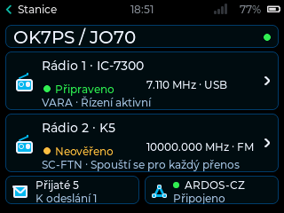 |
| F02 Detail rádia | 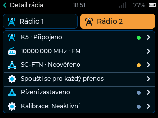 |
| F03 Přenosy | 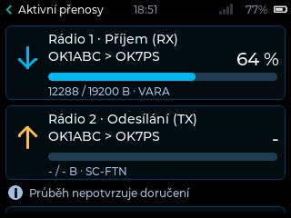 |
| F04 Ovládání | 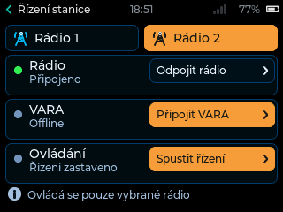 |
| F04 Potvrzení zastavení | 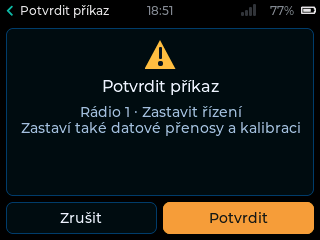 |
| F05 Zařazený maják | 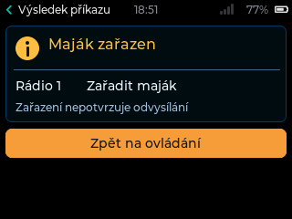 |
| Společný neznámý výsledek | 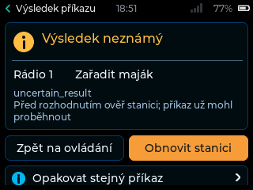 |
| F07 Ladění | 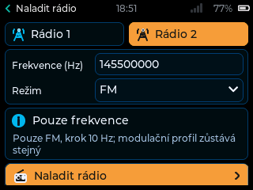 |
| F07 Potvrzení přesných hodnot | 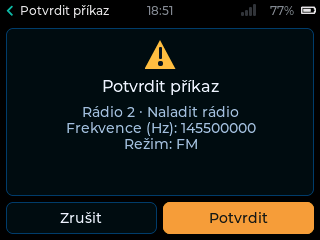 |
| F08 Profily | 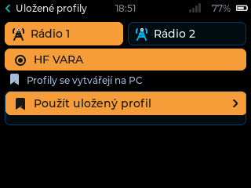 |
| F09 AutoTune | 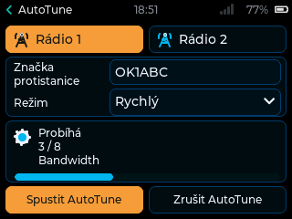 |
| F10 Historie upozornění | 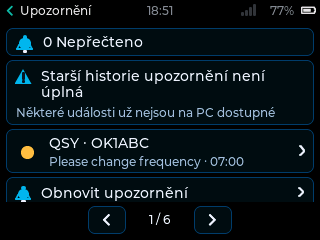 |
| F10 Detail upozornění | 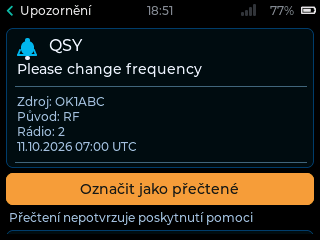 |
| F10 Nouzový alarm, celý text se posouvá | 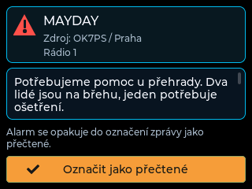 |
| OTA Dostupná aktualizace | 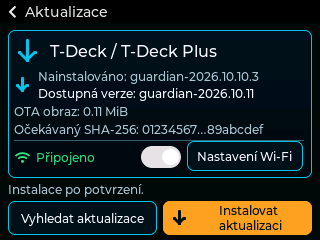 |
| OTA Stahování | 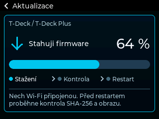 |
| OTA Úspěšně ověřený obraz | 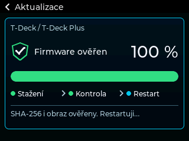 |
